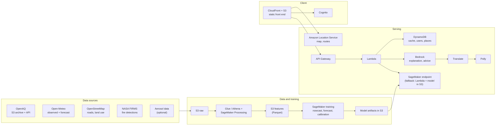
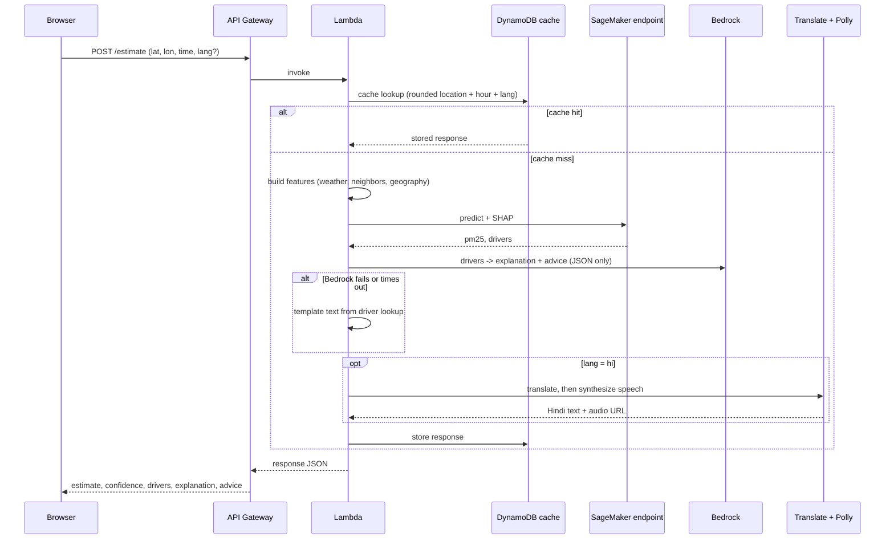
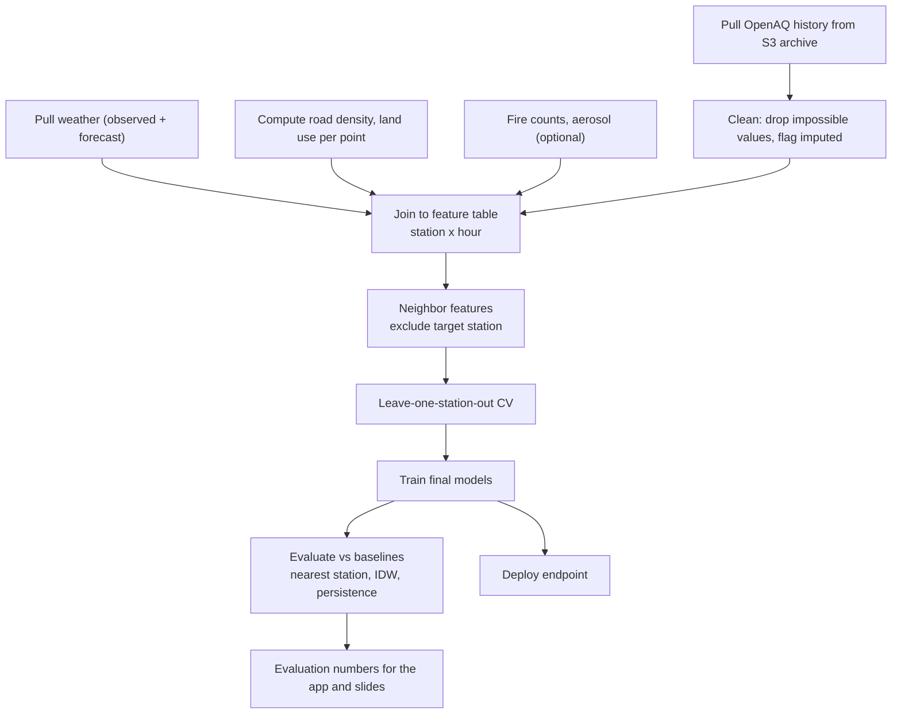
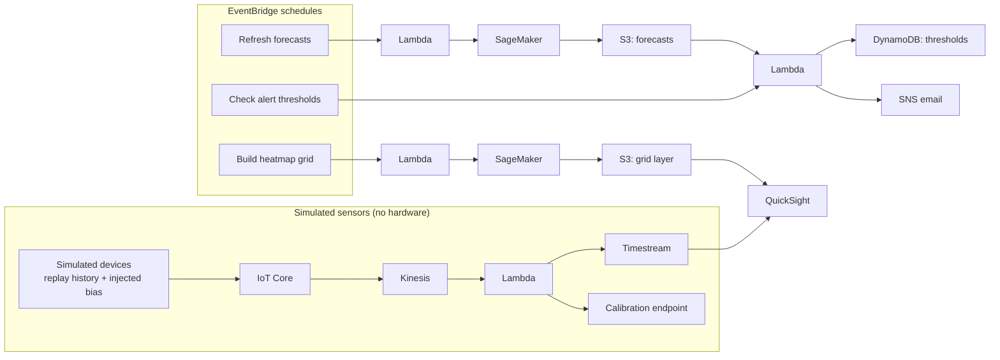

# Architecture: Explainable Street-Level AQI

Environmental Hacks (DTU), Air track. AWS-first, no hardware.

This document describes how the system is built. The product requirements are in the PRD; the build order is in its priority checklist (section 21). Items marked **(Tier N)** map to that checklist, so you can see what exists at each stopping point.

## 1. System at a glance

A browser app sends a latitude, longitude, and time to an API. The API asks a trained model for a PM2.5 estimate, gets SHAP drivers for it, and asks Bedrock to turn the drivers into a plain-language explanation. Everything else (forecast, heatmap, routes, alerts, calibration, dashboard) reuses the same data lake, features, and estimator.

## 2. Components

| Layer | Service | Responsibility | Tier |
|---|---|---|---|
| Hosting | S3 + CloudFront (or Amplify) | Static front end | 1 |
| Map | Amazon Location Service | Map tiles, route candidates | 1, 7 |
| API | API Gateway | Public endpoints, throttling, auth hook | 0 |
| Compute | Lambda | Request handling, feature lookup, assembly of the response | 0 |
| Storage | S3 | Raw data, features, model artifacts, map layers, audio cache | 0 |
| Query | Athena, Glue | Joins and queries over the lake, dashboard source | 1, 11 |
| Training | SageMaker | Nowcast, forecast, and calibration models | 1, 5, 9 |
| Inference | SageMaker endpoint (fallback: Lambda loads the model from S3) | PM2.5 prediction | 1 |
| Explainability | SageMaker Clarify, or the `shap` library as fallback | SHAP drivers per prediction | 2 |
| Language | Bedrock | Plain-language explanation and advice | 2 |
| Language | Translate, Polly | Hindi text and audio | 4 |
| State | DynamoDB | Response cache, users, saved places, thresholds, city registry | 1, 8 |
| Auth | Cognito | Sign-in for saved places and alerts | 8 |
| Scheduling | EventBridge | Forecast refresh, grid job, alert checks | 5, 6, 8 |
| Messaging | SNS | Email alerts | 8 |
| Stream (simulated) | IoT Core, Kinesis, Timestream | Simulated low-cost sensor feed for calibration | 9 |
| Analytics | QuickSight | Authority dashboard | 11 |
| Observability | CloudWatch | Logs, metrics, alarms | 0 |

## 3. Request flow: click to explanation

Design points:

- **Feature building happens in Lambda.** It reads the latest station readings and weather for the requested hour from a small hot store (DynamoDB or S3), computes neighbor features with the target station excluded, and passes a feature vector to the model.
- **Confidence is computed outside the model.** It comes from distance to the nearest station and the spread of nearby readings, with thresholds fixed after looking at validation error versus distance.
- **Bedrock never sees raw data.** It receives only the top drivers, the category, and the confidence, and must answer in JSON using only those inputs.
- **Caching** keys on rounded location, hour, and language, so repeated demo clicks are fast and cheap.

## 4. Data and training pipeline

- **Models:** gradient-boosted trees (XGBoost). One nowcast model, forecast models per horizon bucket (1-6 h, 7-24 h, 25-48 h), and a calibration model for low-cost sensors.
- **Leakage rule:** a station's own reading is never part of its own neighbor features. This is the most important correctness check in the project.
- **Evaluation:** leave-one-station-out error against nearest-station and inverse-distance baselines; forecast error by horizon against persistence; calibration error before and after.
- **Uncertainty:** distance-based confidence, plus quantile models for prediction intervals.

## 5. Scheduled jobs and the simulated sensor stream

- The sensor stream is simulated by replaying historical station data with a humidity-dependent bias and noise added. If real public low-cost sensor data is found, it replaces the simulation.
- Anything built on simulated data is labeled as simulated in the UI, the slides, and the README.

## 6. API surface

| Endpoint | Purpose | Tier |
|---|---|---|
| `POST /estimate` | PM2.5, category, confidence, nearest-station distance, drivers, explanation, advice. Optional `lang` and `audio`. | 1-4 |
| `GET /stations` | Station markers with latest readings | 1 |
| `GET /forecast` | 48-hour series with intervals and peak-hour drivers | 5 |
| `GET /grid` | Precomputed heatmap layer | 6 |
| `POST /route` | Candidate routes ranked by exposure | 7 |
| `GET /cities` | City registry | 10 |
| `POST /subscriptions`, `GET /subscriptions` | Saved places and thresholds (authenticated) | 8 |
| `POST /calibrate` | Corrected sensor reading with drivers | 9 |

Errors return a structured code. If Bedrock fails, `/estimate` still succeeds with `explanation_source: "fallback"`.

## 7. Data stores

| Store | Contents | Notes |
|---|---|---|
| S3 `raw/` | OpenAQ files, weather pulls, OSM extract, fire data | Partition by source and date |
| S3 `features/` | Parquet feature tables per city | Queried by Athena |
| S3 `models/` | Trained model artifacts | Used by the endpoint and the Lambda fallback |
| S3 `layers/` | Forecasts and grid layers | Written by scheduled jobs |
| S3 `audio/` | Cached Polly output | Keyed by explanation hash |
| DynamoDB `cache` | API responses | Short time-to-live |
| DynamoDB `users`, `places` | Saved places, thresholds, channel | Keyed by Cognito user id |
| DynamoDB `cities` | Bounding box, timezone, station ids, model settings | Drives multi-city |
| Timestream | Simulated sensor readings | Calibration module only |

## 8. Security

- Least-privilege IAM role per Lambda, scoped to the buckets and tables it needs.
- No keys in the front end. OpenAQ and FIRMS keys live in Secrets Manager or encrypted Lambda environment variables, and are used only by backend jobs.
- OpenAQ is called from backend jobs only, not from the browser, as its FAQ advises.
- API Gateway throttling and CORS limited to the front-end origin.
- Authenticated routes (`/subscriptions`) use a Cognito authorizer.
- Bedrock Guardrails can be added to block unsupported claims, but the prompt already restricts the model to the drivers it is given.

## 9. Reliability and fallbacks

| Failure | Fallback |
|---|---|
| SageMaker endpoint quota or setup delay | Lambda loads the model file from S3 and predicts directly |
| Bedrock access or errors | Template explanation built from the driver lookup table |
| Clarify setup problems | `shap` library in the endpoint or Lambda |
| Weather API limit or outage | Pre-pulled weather in S3 for the demo window |
| Location Service returns no route alternatives | Generate alternatives by adding waypoints |
| Live demo network failure | Cached responses and a recorded backup video |

## 10. Observability and cost control

- CloudWatch logs for every Lambda, with an alarm on error rate and latency of `/estimate`.
- Log which explanation source was used, so you know how often the fallback fires.
- Budget alarm set in hour 1.
- Stop the SageMaker endpoint and any notebook instances when not demoing.
- Keep the grid job and forecast refresh on a modest schedule; they only need to be fresh for the demo.

## 11. Deployment

- Define the stack with infrastructure as code (CDK or SAM) if you have the time; otherwise script the console steps in the README so the environment can be rebuilt.
- One region for everything, chosen in Tier 0 based on Bedrock, Translate, Polly, and SageMaker availability.
- Deploy after every tier and smoke-test `/estimate` from a clean browser.

## 12. Open items to confirm

- Region, and which Bedrock model is enabled for the account.
- Real Delhi station count and missing-hour rate in OpenAQ (decides how strong the validation can be).
- Whether Location Service returns route alternatives in the chosen region.
- Whether usable aerosol data and real low-cost sensor data exist for the target cities.
- Hackathon rules on AWS credits, allowed services, and submission format.
