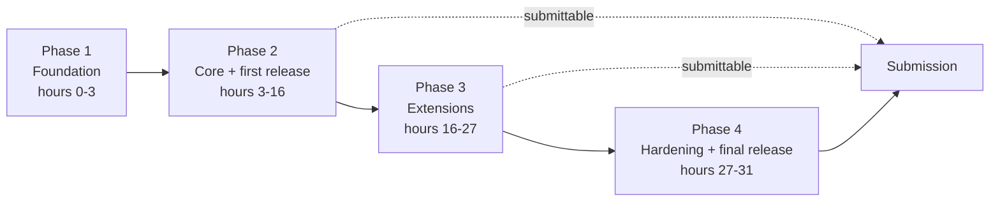

# Phases: Production and Deployment

Explainable Street-Level AQI, Environmental Hacks (DTU). Two people, about 31 elapsed hours (includes sleep, so plan roughly 20 working hours), AWS-first, no hardware.

The work is split into four phases. Each phase has a build part and a deployment part, a gate that must pass before moving on, and a clear statement of what you can submit if you stop there. Tier numbers refer to the priority checklist in the PRD.

## Overview

| Phase | Name | Elapsed hours | Tiers | If you stop here |
|---|---|---|---|---|
| 1 | Foundation | 0-3 | 0 | Nothing to submit yet |
| 2 | Core product and first release | 3-16 | 1, 2, 3 | A complete, submittable project |
| 3 | Extensions | 16-27 | 4-11 | Core plus whichever extras are finished |
| 4 | Hardening and final release | 27-31 | 12 | The final submission |

The key design choice: **Phase 2 ends with a full submission pack**, so Phases 3 and 4 only improve something that is already deliverable.

---

## Phase 1: Foundation (hours 0-3)

**Goal:** remove every blocker and prove the plumbing works with fake data.

### Build

- Confirm the region, and enable Bedrock model access, Translate, and Polly.
- Request SageMaker instance quota. Decide the Lambda-inference fallback now.
- Register the OpenAQ API key and the NASA FIRMS MAP_KEY.
- Pull 6 to 12 months of Delhi PM2.5 from the OpenAQ S3 archive. Count stations and missing hours.
- Agree the API contract and the city-registry format.
- Create the repo, branch rules, and a shared notes file.

### Deploy

- Create the S3 buckets (raw, features, models, layers, front end).
- Set a billing alarm and least-privilege IAM roles for both people.
- Deploy a mocked `/estimate` behind API Gateway and Lambda, and call it from a static page on S3 and CloudFront.

### Environments

- One AWS account and one region.
- Two API Gateway stages from the start: `dev` (for building) and `demo` (stable, for judging). Only promote to `demo` after a smoke test.

### Gate to move on

- [ ] A mock request flows from the browser through API Gateway and Lambda and back.
- [ ] Keys are registered and stored safely.
- [ ] You know how many Delhi stations and how many missing hours you really have.
- [ ] Bedrock responds in the chosen region.

### Risks and responses

| Risk | Response |
|---|---|
| Bedrock model access not approved | Plan template explanations; keep asking in parallel |
| SageMaker quota delayed | Use Lambda inference with the model file in S3 |
| Station data far sparser than expected | Keep the plan, report it honestly, show error by distance |

---

## Phase 2: Core product and first release (hours 3-16)

**Goal:** a working click-to-estimate product with explanations and evidence, packaged for submission.

### Build

**Core estimate (Tier 1)**

- Pull and join weather data, build features, and exclude each station from its own neighbor features.
- Baselines: nearest-station and inverse-distance average.
- Train XGBoost and deploy it (SageMaker endpoint, or the Lambda fallback).
- Map with station markers, time selector, and a side panel showing PM2.5, category, confidence, and nearest-station distance.

**Explain and prove (Tier 2)**

- Leave-one-station-out evaluation against both baselines, plus an error-by-distance chart.
- SHAP top three drivers from the endpoint.
- Bedrock explanation and advice, with a template fallback.
- "How accurate is this?" view with the real numbers and stated limits.

**Submission pack v1 (Tier 3)**

- Architecture diagram, slides, a 3-minute demo video, and a README.

### Deploy

- Deploy the real endpoint and Lambda to `dev`, then promote to `demo` after a smoke test.
- Publish the front end to S3 and CloudFront and test it from another device and network.
- Turn on CloudWatch alarms for `/estimate` errors and latency.
- Pre-warm the endpoint and enable the response cache.

### Release procedure (reuse every time)

1. Merge to main only if the core flow passes.
2. Deploy to `dev` and run the smoke test: click a point, check estimate, confidence, drivers, explanation, and the evaluation view.
3. Promote the Lambda version and API stage to `demo`.
4. Sync the front-end build to S3 and invalidate CloudFront.
5. Re-test from a clean browser.
6. Record a short clip of anything that changed.

### Rollback

- Keep the previous Lambda version behind an alias, and revert the alias if the smoke test fails.
- Keep the previous front-end build in S3 under a versioned prefix so it can be restored by re-syncing.

### Gate to move on

- [ ] Clicking any Delhi point returns a real estimate with confidence and reasons.
- [ ] The evaluation view shows the model against both baselines with real numbers.
- [ ] The deployed URL works from a clean browser on another network.
- [ ] Architecture diagram, slides, README, and a recorded demo video exist.
- [ ] The README states the limits and what is implemented.

**If you stop here:** you have a complete submission. This is the minimum good project.

### Risks and responses

| Risk | Response |
|---|---|
| Leakage makes accuracy look too good | Re-check that the target station is excluded; investigate any large margin |
| Bedrock fails during the demo | Template fallback is already in place |
| Endpoint slow on first call | Pre-warm, cache, and use cached demo points |

---

## Phase 3: Extensions (hours 16-27)

**Goal:** add value on top of a project that can already be submitted, one finished module at a time.

### Build order

Work in this order. Finish each module to a demoable state before starting the next.

1. Hindi text and audio (Translate and Polly).
2. 48-hour forecast with evaluation by horizon against the persistence baseline.
3. Heatmap grid, and in parallel fire and aerosol features if the data pulls cleanly.
4. Lowest-exposure route.
5. Accounts and alerts (Cognito, DynamoDB, EventBridge, SNS email).
6. Sensor calibration with the simulated stream, clearly labeled.
7. Multi-city, with cities chosen from measured data coverage.
8. Authority dashboard in QuickSight.

### Deploy

- Each module ships behind a feature flag, off by default.
- Turn a flag on only after the module passes its own smoke test on `dev`.
- Promote to `demo` module by module, never several at once.
- Add the new endpoint to API Gateway, with its own throttling and error alarm.
- Add scheduled jobs (EventBridge) last, after the module works when triggered by hand.

### Per-module done criteria

| Module | Done when |
|---|---|
| Hindi and audio | Toggle switches the explanation to Hindi and audio plays |
| Forecast | Chart shows 48 hours with intervals, error beats persistence at each horizon bucket |
| Heatmap | Layer loads, low-confidence cells look different |
| Route | Two routes compared with time and exposure |
| Alerts | A threshold crossing sends a real email |
| Calibration | Before and after error shown, labeled real or simulated |
| Multi-city | A second city loads end to end |
| Dashboard | Dashboard shows estimates, low-confidence areas, and calibration results |

### Rules for this phase

- After each module: deploy, smoke test, and record a short clip.
- Hide anything unfinished from the UI instead of showing it broken.
- If a module is blocked for over an hour, change the approach, then consider moving on to the next one.
- New ideas go on the "later" list.

### Gate to move on

- [ ] The hour-27 freeze is reached, or every module is done.
- [ ] Every module that is turned on passes its smoke test on `demo`.
- [ ] Core flow still works exactly as before.

**If you stop here:** you can submit the core plus every extra that is finished and enabled.

### Risks and responses

| Risk | Response |
|---|---|
| Extras threaten the stability of the core | Feature flags, `dev` before `demo`, and rollback by alias |
| Simulated sensor results look circular | Use real low-cost data if any exists; otherwise label as a pipeline demonstration |
| Location Service returns no route alternatives | Build alternatives with waypoints |
| Uneven city coverage | Choose cities by measured data and show confidence |

---

## Phase 4: Hardening and final release (hours 27-31)

**Goal:** freeze the scope and make the final submission safe, accurate, and rehearsed.

### Build

- **Freeze:** no new modules. Bug fixes only.
- Hide or remove anything unfinished, including from the slides.
- Update the slides and architecture diagram to match exactly what is deployed.
- Update the README with implemented, partial, and not-built features, data credits, and how to run.
- Check every number on the slides against the saved evaluation outputs.

### Deploy

- Final promotion to `demo` of the chosen set of enabled modules.
- Pre-warm the endpoint, fill the cache for planned demo clicks, and confirm pre-pulled data covers the demo window.
- Run the full smoke test from a clean browser and a second network.
- Re-record the demo video to match the final product, and back it up in two places.
- Check CloudWatch for errors, and confirm the billing alarm is still set.

### Final release checklist

- [ ] Deployed URL works from a clean browser and another network
- [ ] Demo video re-recorded (about 3 to 5 minutes) and backed up
- [ ] Slides match the deployed product
- [ ] Architecture diagram matches what is deployed
- [ ] README lists implemented, partial, and not-built features
- [ ] Simulated data is labeled everywhere it appears
- [ ] Evaluation numbers match the saved outputs
- [ ] No keys, credentials, or private data in the repo
- [ ] Billable resources handled according to the hackathon's rules
- [ ] Submission form filled in and confirmation saved

### Rehearsal

- Rehearse the demo twice, timed, with the backup video ready.
- Prepare answers for the likely questions: sparse stations, leakage, false confidence, why estimates are not measurements, and what is simulated.

### Rollback and contingency

| Situation | Action |
|---|---|
| Smoke test fails after the last change | Revert the Lambda alias and the front-end build to the previous version |
| An extra breaks near the end | Turn its flag off, remove it from the slides, keep the rest |
| Network or API trouble during judging | Use cached responses and the recorded video |
| Submission portal slow or failing | Submit early, with at least 3 hours of margin, and save the confirmation |

**Result:** the final submission.

---

## Summary of release controls

| Control | Purpose |
|---|---|
| `dev` and `demo` stages | Build safely, release only tested work |
| Smoke test before every promotion | Protect the core flow |
| Lambda aliases and versioned front-end builds | Fast rollback |
| Feature flags per module | Ship extras without risking the core |
| Short clip after every change | Keeps the demo video easy to update |
| Hour-27 freeze | Leaves time for a safe submission |
